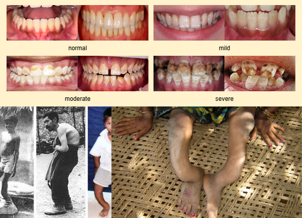
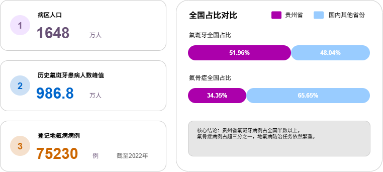
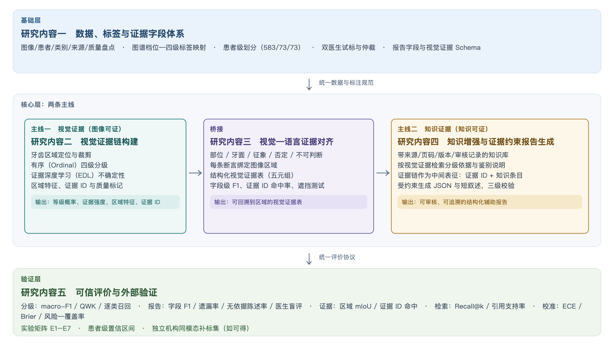
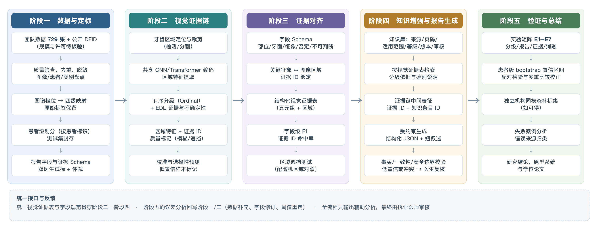
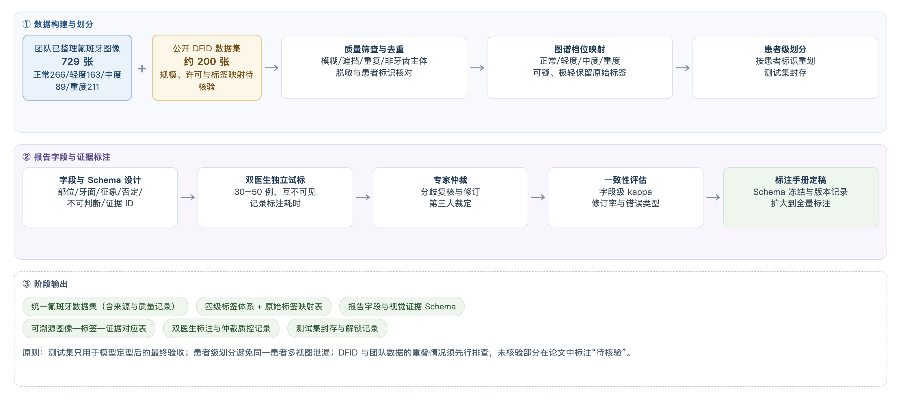
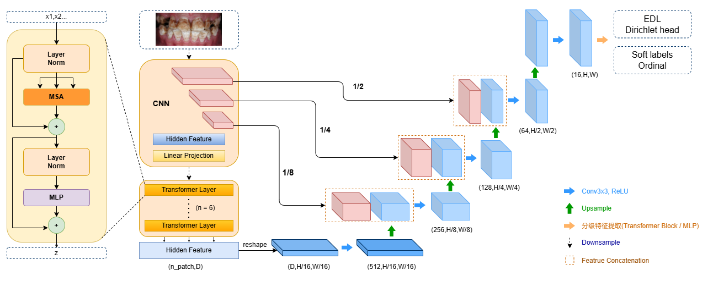
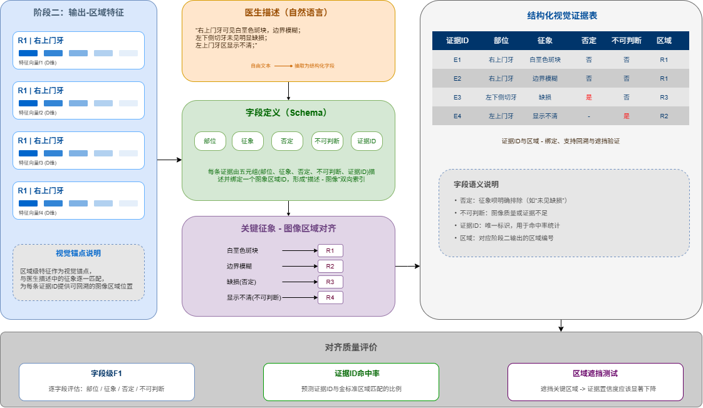
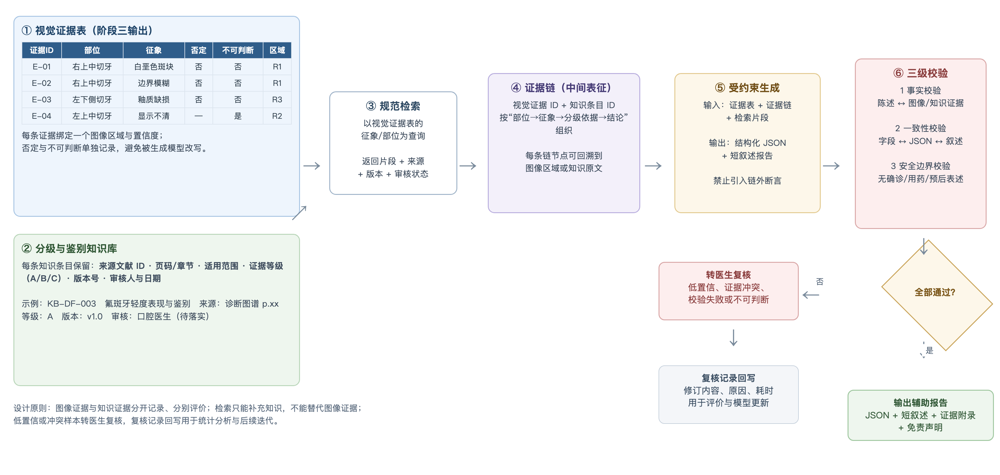

# 贵州大学硕士研究生学位论文开题报告（修订稿）

**所在学院**：计算机科学与技术学院　**学号**：2025022347　**姓名**：覃建海
**学科专业**：计算机科学与技术　**研究方向**：计算机应用技术
**开题题目**：基于视觉证据对齐与知识增强的氟斑牙分级辅助报告生成方法研究
**导师姓名**：吴云　**开题时间**：2026年12月1日

> 说明：本文件为正文文字版，与同目录 `开题报告-修订稿-20261119.docx` 内容一致；修订依据见 `修改说明.md`。

## 一、论文所属课题来源、名称、编号

课题来源：国家自然科学基金

课题名称：贵州省地氟病骨骼病变图像的智能检测与识别

课题编号：国家自然科学基金(62266011)

## 二、立项依据与研究内容（3000-5000字）。

### 1．论文的立项依据（研究意义、国内外研究现状及发展动态分析，需结合科学研究发展趋势来论述科学意义；或结合国民经济和社会发展中迫切需要解决的关键科技问题来论述其应用前景。附主要参考文献目录）。

#### 1.1 研究意义

地方性氟中毒（地氟病）是人体长期摄入过量氟元素引起的全身性慢性疾病，临床主要表现为氟斑牙和氟骨症（图1）。氟斑牙是氟暴露早期最敏感的体征，表现为牙釉质白垩色斑块、着色及不同程度牙体缺损，不仅影响美观，还可增加龋齿、釉质磨损风险，对儿童青少年身心健康产生长期影响[1-2]。

图1 氟斑牙（上）和氟骨症（下）示例

中国是全球地氟病流行范围较广、受危害人口较多的国家之一，贵州省曾是世界上人口最多、病区最集中、病情最严重的地氟病重症区之一。依据《2022中国卫生健康统计年鉴》，贵州省病区人口1648万人，氟骨症、氟斑牙病例分别占全国34.35%和51.96%，历史氟斑牙患病人数峰值达986.8万人；《2023中国卫生健康统计年鉴》显示，截至2022年底全省登记地氟病病例75230例（图2）。综合防治后病区儿童患病程度明显改善：遵义市播州区新民镇朝阳村8～12岁儿童氟斑牙检出率由2009年的33.7%降至2023年的16.4%；但居民地氟病知晓率由100%降至23.3%，正确使用炉灶率由0%提高到61.6%[1]。防治成效尚不稳固，基层筛查与长期随访仍需持续投入。

图2 贵州省地氟病患者数量统计（数据来源：《2022中国卫生健康统计年鉴》《2023中国卫生健康统计年鉴》）

目前氟斑牙诊断主要依赖口腔医生对牙齿图像肉眼观察并依据标准分级，人工判读存在四方面不足：一是过程耗时，大规模筛查重复劳动多；二是分级受经验与主观判断影响，观察者间一致性有限；三是病区多在农村和偏远地区，口腔专业资源匮乏，基层医生难以及时获得规范支持；四是筛查记录与报告缺少统一结构，复核、质控和流行病学统计成本较高。

近年来，深度学习在氟斑牙分级方面取得进展。Gu等[2]建立氟斑牙图像数据集，提出“大核卷积U-Net分割＋像素关联迭代＋CNN/Transformer双分支分类”的两阶段方法；Xu等[3]提出随机掩码潜在Transformer，在DFID上取得80.19%准确率、75.79% F1和81.28% QWK；Li等[4]提出轻量化LD2Net，在保持80.00%准确率和79.88% macro-F1的同时显著降低参数量与计算量。但现有研究多止于“输出类别、掩码或热图”：模型难以说明依据了哪些牙位、牙面和征象；报告中的分级依据与鉴别说明缺少可追溯的知识来源；医生复核时仍需重读图像、手工整理文字。分级模型与临床报告之间仍存在明显断层。

针对上述问题，本研究拟构建“视觉证据对齐＋知识增强”的氟斑牙分级辅助报告生成方法：以牙齿区域定位和四级分级为基础，输出可回溯到图像区域的征象证据；以带来源记录的知识库补充分级依据和鉴别说明；以受证据约束的生成模型组织结构化字段与短叙述，并将低置信度或证据冲突样本转交医生复核。其意义在于：（1）降低基层筛查中的人工判读与报告整理成本；（2）将图像证据与知识证据分开溯源，提高报告的可解释性与可审核性；（3）为防治档案、健康教育和流行病学统计提供结构化数据基础。本系统输出医学辅助分析结果，不替代临床诊断，最终报告须由执业医师审核。

#### 1.2 国内外研究现状及发展动态分析

本节从氟斑牙影像分级、医学报告生成与视觉语言模型、知识增强与检索增强生成、可信评价与不确定性四方面梳理现状，并分析不足。

##### （1）氟斑牙影像分级研究

氟斑牙分级的难点在于病灶区域小、边界不清、表现受染色和光照影响，且相邻级别易混淆。Gu等[2]采用大核卷积U-Net分割牙齿区域，以像素关联迭代优化分割，再用CNN与Transformer双分支融合分类；Xu等[3]以潜在嵌入和掩码token预测增强上下文建模，在DFID上取得80.19%准确率、75.79% F1和81.28% QWK；Li等[4]以深度可分离卷积和双轴注意力实现轻量化，参数量与计算量降低80%以上。Xu等[5]针对氟骨症X线提出Mwinc-Mamba，在SFXRay上取得二分类83.33%、多分类66.67%的准确率，说明CNN与全局建模结合对氟中毒相关影像分级有参考价值，但其任务不能作为氟斑牙照片的外部验证。尹子源等[6]提出QOD-UNeXt，通过四象限斜向特征位移和局部特征融合实现轻量牙齿分割。总体看，现有工作多以图像级分类为终点，缺少“哪个牙位、哪个牙面、何种征象支持该级别”的结构化表达；公开数据规模有限，据文献[4]报道DFID仅约200个样本（规模与许可待核验），跨中心验证和报告标签建设仍待解决。

##### （2）医学报告生成与视觉语言模型

思维链提示通过显式生成中间推理步骤提升复杂推理能力[20]，已被引入医学报告生成。早期研究多采用CNN-RNN编码器—解码器、检索—生成混合模型和记忆驱动Transformer[7-9]；近年来通用视觉语言模型与医学基础模型使报告生成从模板填充走向端到端生成[10-11]。Xiao等[12]提出R3-Gen，以医学知识图谱为事实骨架合成知识接地的思维链数据，再以“医学对齐—推理指令微调—临床奖励强化”渐进训练，使模型同时输出报告与可检查的推理链；在MIMIC-CXR上CheXbert F1由0.172提升至0.408，短语定位mIoU达0.373。该工作表明，以证据链作为报告生成的中间表征并约束证据与结论的对应，可同时改善临床效能与可检查性；其局限是仅验证胸片与英文报告、以自动指标为主，且推理链“看似合理”不等于忠实。牙科领域的报告生成多面向全景片、CBCT或口内扫描，针对氟斑牙口内照片、强调分区证据与知识溯源的研究较少（据检索未见系统报道，待核验）。

##### （3）知识增强与检索增强生成

检索增强生成（RAG）通过外部知识为语言模型提供证据，已用于医学问答与报告生成[13-15]。在放射学报告中，事实感知的多模态检索可提升事实一致性；知识库条目需保留来源、版本和审核记录，否则检索结果难以复核。RAG能补充分级依据与鉴别说明，但不能恢复图像中缺失的证据；视觉不确定性与知识不足是两个正交问题，应分别验证。现有牙科RAG多面向问答或诊断建议，面向氟斑牙分级报告且将“图像可证”与“知识可证”分开评价的工作仍较少。

##### （4）可信评价与不确定性

临床应用中，模型还需说明“有多确定”。证据深度学习（EDL）以Dirichlet分布建模分类证据，可同时输出类别概率、证据强度和不确定性[16]；温度缩放、ECE和Brier分数可评价置信度是否可靠[17]；选择性预测通过风险—覆盖率曲线决定哪些样本转人工[18]。现有氟斑牙分级研究多报告准确率、F1和Kappa，较少同时报告校准、选择性预测和报告级事实性，跨中心、跨设备下置信度是否可用仍缺少验证。

##### （5）小结

综上，现有研究存在三个缺口：一是分级模型与报告生成分离，分级结果难以转化为可审核的结构化报告；二是视觉证据与语言描述缺少稳定对齐，征象、否定和不可判断项难以回溯到图像区域；三是图像证据与知识证据未分开溯源，事实性、引用覆盖率和引用支持率缺少可复现评价。本研究拟将分级、证据对齐、知识检索和受约束报告生成纳入统一流程，并通过消融实验和外部验证检验其有效性。

##### 主要参考文献

[1] 顾茂华, 吴云, 王世杰, 江中川. 遵义市新民镇朝阳村2009与2023年地氟病情况调查分析[J]. 中国地方病防治, 2024, 39(3): 189-191.

[2] Gu M, Wu Y, Jiang Z, Xu H. Integrated method for grading diagnosis of dental fluorosis combined with segmentation and classification[J]. Biomedical Signal Processing and Control, 2024, 96: 106510. DOI: 10.1016/j.bspc.2024.106510.

[3] Xu H, Wu Y, Wu J, Xie R, Gu M, Wang R. Masked latent transformer with random masking ratio to advance the diagnosis of dental fluorosis[J]. Journal of Visual Communication and Image Representation, 2025, 111: 104496. DOI: 10.1016/j.jvcir.2025.104496.

[4] Li M, Wu Y, Li Z, Ye C. LD2Net: real-time lightweight fluorosis grading with depthwise separable convolution and dual-axis attentional intelligence[J]. Journal of Real-Time Image Processing, 2026, 23: 85. DOI: 10.1007/s11554-026-01874-4.

[5] Xu H, Wu Y, Xie R, Xu J, Wu J, Wang R, Tian Y. Convolutional state space model with multi-window cross-scan to advance the automated diagnosis of skeletal fluorosis[J]. Biomedical Signal Processing and Control, 2025, 103: 107439. DOI: 10.1016/j.bspc.2024.107439.

[6] 尹子源, 吴云. 四象限斜向特征位移的轻量级牙齿图像分割[J]. 激光与光电子学进展, 2025, 62(10): 1037007. DOI: 10.3788/LOP242111.

[7] Jing B, Xie P, Xing E P. On the automatic generation of medical imaging reports[C]//Proceedings of the 56th Annual Meeting of the Association for Computational Linguistics (ACL). 2018: 2577-2586.

[8] Li C Y, Liang X, Hu Z, Xing E P. Hybrid retrieval-generation reinforced agent for medical image report generation[C]//Advances in Neural Information Processing Systems (NeurIPS). 2018: 1530-1539.

[9] Chen Z, Song Y, Chang T H, Wan X. Generating radiology reports via memory-driven transformer[C]//Proceedings of the 2020 Conference on Empirical Methods in Natural Language Processing (EMNLP). 2020: 1439-1449.

[10] Moor M, Banerjee O, Abad Z S H, et al. Foundation models for generalist medical artificial intelligence[J]. Nature, 2023, 616(7956): 259-265.

[11] Tu T, Azizi S, Driess D, et al. Towards generalist biomedical AI[J]. NEJM AI, 2024, 1(3): AIoa2300138.

[12] Xiao T, Qiu Y, Yang H, Wang Z. R3-Gen: Enhancing medical report generation with reasoning-reinforced fine-tuning[J]. Pattern Recognition, 2027, 183: 115111. DOI: 10.1016/j.patcog.2026.115111.

[13] Lewis P, Perez E, Piktus A, et al. Retrieval-augmented generation for knowledge-intensive NLP tasks[C]//Advances in Neural Information Processing Systems (NeurIPS). 2020: 9459-9474.

[14] Zakka C, Shad R, Chaurasia A, et al. Almanac — Retrieval-augmented language models for clinical medicine[J]. NEJM AI, 2024, 1(2): AIoa2300068.

[15] Gao Y, Xiong Y, Gao X, et al. Retrieval-augmented generation for large language models: A survey[J]. arXiv preprint arXiv:2312.10997, 2023.

[16] Sensoy M, Kaplan L, Kandemir M. Evidential deep learning to quantify classification uncertainty[C]//Advances in Neural Information Processing Systems (NeurIPS). 2018: 3179-3189.

[17] Guo C, Pleiss G, Sun Y, Weinberger K Q. On calibration of modern neural networks[C]//Proceedings of the 34th International Conference on Machine Learning (ICML). 2017: 1321-1330.

[18] Geifman Y, El-Yaniv R. Selective classification for deep neural networks[C]//Advances in Neural Information Processing Systems (NeurIPS). 2017: 4878-4887.

[19] Niu Z, Zhou M, Wang L, Gao X, Hua G. Ordinal regression with multiple output CNN for age estimation[C]//Proceedings of the IEEE Conference on Computer Vision and Pattern Recognition (CVPR). 2016: 4920-4928.

[20] Wei J, Wang X, Schuurmans D, et al. Chain-of-thought prompting elicits reasoning in large language models[C]//Advances in Neural Information Processing Systems (NeurIPS). 2022: 24824-24837.

[21] Hu E J, Shen Y, Wallis P, et al. LoRA: Low-rank adaptation of large language models[C]//International Conference on Learning Representations (ICLR). 2022.

### 2．论文的研究内容、研究目标，以及拟解决的关键科学问题（此部分为重点阐述内容）。

#### 2.1 研究内容

本研究围绕氟斑牙分级辅助报告生成开展五项相互衔接的研究（图3）。五项内容归为两条主线：一是构建可回溯到图像区域的视觉证据链；二是在视觉证据与知识证据共同约束下生成可审核的报告。数据与字段体系是共同基础，可信评价贯穿全过程。

图3 研究内容框架

1）数据、标签与证据字段体系构建。在团队数据和公开DFID基础上完成图像、患者、类别、来源和质量盘点；以“正常、轻度、中度、重度”四级为主线，建立图谱档位、样本文件名与公开数据标签的映射表，原始标签保留；按患者划分训练、验证和测试集，测试集只用于最终验收；设计报告字段与视觉证据字段，开展双医生标注与仲裁，为分级和报告评价提供统一基准。

2）视觉证据链构建。构建共享CNN/Transformer编码器，先完成牙齿区域定位与裁剪，再进行四级分级；分类损失引入有序（Ordinal）约束[19]，采用证据深度学习（EDL）输出类别概率、证据强度及总体/数据/模型不确定性；为每个牙齿区域保留区域编号、特征向量、质量标记和证据ID，形成可被语言侧引用的视觉证据单元。

3）视觉—语言证据对齐。复用第2）项的区域特征，定义部位、牙面、征象、否定、不可判断和证据ID等字段，将医生描述中的关键征象与图像区域对齐，输出结构化视觉证据表，使每条视觉断言都能回溯到具体牙位、牙面和图像区域，而不是只给出类别或热图。

4）知识增强与证据约束报告生成。构建面向氟斑牙分级与鉴别的知识库，每条知识保留来源文献ID、页码、适用范围、证据等级、版本和审核记录；检索模块根据视觉证据表返回片段及其来源；以“视觉证据ID＋知识条目ID”构成证据链作为中间表征，在证据链约束下生成结构化JSON与短叙述，并执行事实、一致性和安全边界校验，低置信度或证据冲突样本转医生审核。

5）可信评价与外部验证。从分级、报告、证据、检索和校准五方面建立评价协议：分级采用macro-F1、QWK和逐类召回；报告采用字段F1、遗漏率、无依据陈述率、结构有效率和医生盲评；证据采用区域mIoU和证据ID命中率；检索采用Recall@k、引用覆盖率和引用支持率；校准采用ECE、Brier和风险—覆盖率。通过消融实验隔离组件贡献，并在DFID和（如可得）独立机构同模态补标集上验证。

#### 2.2 研究目标

（1）建立可复核的氟斑牙四级标签、报告字段与视觉证据字段规范，完成患者级数据划分和双医生试标；

（2）构建视觉证据驱动的分级模型，在统一划分上取得与现有公开方法可比的macro-F1和QWK，并给出校准与选择性预测结果；

（3）建立视觉—语言证据对齐模块，使部位、征象、否定和不可判断项能够回溯到证据ID，并完成定位一致性评价；

（4）构建知识增强的报告生成流程，输出结构化JSON与短叙述，完成引用覆盖率、引用支持率和无依据陈述率评价；

（5）完成内部验证和（如可得）外部补标集验证，形成可复现的实验记录、原型系统和论文初稿。

#### 2.3 拟解决的关键科学问题

（1）分级定标与标签一致性。在《氟斑牙诊断图谱》档位、样本文件名和公开数据标签不完全一致时，如何建立可复核的四级标签体系，并保证患者级划分、牙齿级判定与报告字段一致？这是指标可比的前提。

（2）视觉证据与语言证据的对齐。在病灶小、边界不清、遮挡、染色干扰和相邻级别混淆时，如何使部位、征象、否定和不可判断项稳定回溯到图像区域？证据ID存在不等于区域忠实，需以遮挡实验和随机区域对照检验。

（3）知识接地与幻觉可测。如何将图像证据与知识证据分开溯源，并以引用覆盖率、引用支持率和无依据陈述率可复现地评价报告事实性？检索能补充知识，但不能恢复缺失的图像证据，二者应分别验证。

（4）不确定性与人工复核。如何联合EDL不确定性、检索证据强度和报告风险，构建“直接生成/补充检索/转人工”的可判定规则，并在控制转诊率的同时降低高置信错误？阈值需在试标后确定。

### 3．拟采取的研究方案及可行性分析（包括研究方法、技术路线、实验手段、关键技术等说明）。

#### 3.1 研究方法

本研究采用实验法、经验总结法、比较研究法和文献资料法。以实验法为基础，结合医学图像分类、视觉语言对齐、知识检索与报告生成领域的文献和经验总结；通过双医生标注与仲裁建立参考标准，通过对比实验、消融实验和统计检验验证方法有效性。

#### 3.2 技术路线及实验手段

本研究拟采取的研究方案如图4所示，按“数据与定标—视觉证据链—证据对齐—知识增强与报告生成—验证与总结”五阶段展开，各阶段以统一的视觉证据表、字段规范和评测协议衔接，形成可回溯、可复核的闭环。

图4 技术路线图

阶段一：数据与定标。盘点团队数据和公开DFID的患者数、图像数、类别、来源、质量和重复情况，数据构成见表1，流程如图5所示；以四级为主线建立图谱档位、样本文件名与公开标签的映射（表2），原始标签保留；按患者划分训练、验证和测试集，测试集只用于最终验收；设计报告字段与视觉证据字段，开展双医生独立标注与仲裁试标，记录字段级一致性和修订率。

表1 氟斑牙数据构成与划分

| 数据来源 | 正常 | 轻度 | 中度 | 重度 | 合计 | 用途与说明 |
|---|---:|---:|---:|---:|---:|---|
| 团队已整理图像 | 266 | 163 | 89 | 211 | 729 | 现有固定切分583/73/73；患者级独立性待核验 |
| 示例/试标图像（独立整理） | 50 | 50 | 50 | 50 | 200 | 流程验证与标注试标，文件名单列 |
| 公开DFID | — | — | — | — | 约200 | 规模、许可与标签映射待核验 |

注：示例/试标图像与729张已整理图像的文件名无重叠；两套数据是否存在患者重叠，需在数据盘点时核验。

表2 分级标准映射（待图谱原页与口腔医生确认）

| 图谱/标准档位 | 本研究四级 | 主要表现 | 映射处理 |
|---|---|---|---|
| 正常 | 正常 | 釉质半透明、有光泽，无白垩或着色 | 直接映射 |
| 可疑 | 轻度 | 细小白色斑点或条纹，范围局限 | 并入轻度训练，保留原始标签，分析时单列 |
| 极轻 | 轻度 | 白垩色不透明区小于牙面1/2 | 直接映射 |
| 轻度 | 轻度 | 白垩色不透明区约达牙面1/2 | 直接映射 |
| 中度 | 中度 | 白垩或着色区超过牙面1/2，无明显缺损 | 直接映射 |
| 重度 | 重度 | 全牙面着色并伴实质性缺损 | 直接映射 |

图5 数据集构建与标注优化流程

阶段二：视觉证据链构建。构建共享CNN/Transformer编码器，先完成牙齿区域定位与裁剪，再进行四级分级；引入Ordinal约束和EDL，输出类别概率、证据强度及总体/数据/模型不确定性；为每个区域保留编号、特征向量、质量标记和证据ID，并通过校准与选择性预测标记低置信样本。该阶段如图6所示，并在统一划分上与ResNet、ViT、Swin、Gu等[2]、MLTrMR[3]、LD2Net[4]比较。

图6 氟斑牙病变图像分级模型

阶段三：视觉—语言证据对齐。复用阶段二的区域特征，定义部位、牙面、征象、否定、不可判断、证据ID和置信度等字段（表3）；将医生描述中的关键征象与图像区域对齐，输出结构化视觉证据表；以字段级F1、证据ID命中率和区域遮挡测试评价对齐质量，遮挡测试须设随机区域对照。该阶段如图7所示。

表3 视觉证据表字段

| 字段 | 含义 | 取值示例 | 来源 |
|---|---|---|---|
| evidence_id | 证据唯一编号 | E-03 | 系统生成 |
| tooth_position | 牙位或牙弓区域 | 右上颌中切牙 | 检测与标注 |
| surface | 牙面 | 唇面 | 标注 |
| sign | 征象 | 白垩色斑块 | 模型与标注 |
| negation | 否定表述 | 未见缺损 | 文本解析与医生确认 |
| undetermined | 不可判断 | 图像模糊 | 质量评估 |
| region_id | 图像区域编号 | R2 | 定位模型 |
| confidence | 证据置信度 | 0.87 | 模型输出 |
| knowledge_ref | 关联知识条目 | KB-DF-003 | 检索模块 |

图7 视觉—语言证据对齐与质量评价结构

阶段四：知识增强与证据约束报告生成。构建带来源、页码、适用范围、证据等级、版本和审核记录的知识库；检索模块根据视觉证据表返回片段及来源；报告生成可采用开源视觉语言模型，并以LoRA[21]进行参数高效适配；以“视觉证据ID＋知识条目ID”构成证据链作为中间表征，约束生成结构化JSON与短叙述，并执行事实、一致性和安全边界校验；校验失败、低置信或证据冲突样本转医生审核，复核记录回写用于评价与迭代。该阶段如图8所示。

图8 知识增强与证据约束报告生成流程

阶段五：验证与总结。实验矩阵见表4，评价指标见表5。外部验证优先使用独立机构同模态补标集；DFID可作分级线索和补充验证，SFXRay属氟骨症X线任务，不作为氟斑牙照片的直接外测。最后汇总失败案例，分析图像质量、遮挡、染色和相邻级别混淆等错误来源，形成研究结论、原型系统与学位论文。

表4 实验矩阵

| 编号 | 实验 | 设置 | 目的 |
|---|---|---|---|
| E1 | 分级基线 | ResNet/ViT/Swin/Gu 2024/MLTrMR/LD2Net，统一患者级划分 | 建立可比基线 |
| E2 | 不确定性 | EDL与softmax/温度缩放对比；ECE、Brier、风险—覆盖率 | 验证不确定性可用性 |
| E3 | 证据对齐 | 字段级F1、证据ID命中率、定位一致性、遮挡测试（随机区域对照） | 验证语言证据可追溯 |
| E4 | 报告生成 | 分级套模板、直接VLM/LLM、视觉证据表约束、证据链约束 | 验证证据约束的增益 |
| E5 | 消融 | ±RAG×±不确定性门控；±证据链；±Ordinal；±分割 | 隔离各组件贡献 |
| E6 | 外部验证 | 独立机构同模态补标集；DFID补充验证 | 验证泛化能力 |
| E7 | 效率与鲁棒性 | 参数量、FLOPs、延迟；噪声、模糊、光照扰动 | 验证部署可行性 |

表5 评价指标

| 任务 | 指标 | 说明 |
|---|---|---|
| 分级 | macro-F1、QWK、逐类召回 | 患者级划分，关注类别不平衡 |
| 报告 | 字段F1、遗漏率、无依据陈述率、结构有效率、医生盲评 | 无依据陈述率需医生判定 |
| 证据 | 区域mIoU、证据ID命中率、定位一致性 | 不以热图代替证据 |
| 检索 | Recall@k、引用覆盖率、引用支持率 | 覆盖率与支持率分开报告 |
| 校准 | ECE、Brier、风险—覆盖率 | 判断置信度是否可用 |
| 临床 | 医生修改时间、信任度、错误发现率 | 盲法、顺序平衡 |

实验手段。采用固定患者级划分或五折交叉验证，报告均值±标准差；采用配对检验或bootstrap 95%置信区间，多重比较说明校正方法；对失败案例定性分析，记录图像质量、遮挡、染色和相邻级别混淆等错误来源；同时报告参数量、FLOPs和推理延迟。

#### 3.4 关键技术

（1）分级标准映射与患者级数据划分技术。建立可追溯的图谱档位—四级标签映射表和患者级划分规则，保留原始标签，保证训练、验证、测试之间无患者重叠。

（2）共享视觉编码与不确定性分级技术。以共享CNN/Transformer编码器完成牙齿区域定位、特征提取和四级分级，结合Ordinal约束与EDL输出类别概率、证据强度和不确定性，为低置信样本转人工提供依据。

（3）视觉—语言证据对齐技术。将部位、牙面、征象、否定、不可判断和证据ID定义为统一字段，把医生描述中的关键征象与图像区域对齐，使视觉断言可回溯到牙位、牙面和图像区域。

（4）可追溯知识检索与证据链构建技术。构建带来源、页码、适用范围、证据等级、版本和审核记录的知识条目，检索时返回片段及来源；以视觉证据ID和知识条目ID构成证据链作为报告生成的中间表征；未核验知识标注“待核验”，避免把检索片段当作图像证据。

（5）受约束报告生成与三级校验技术。在视觉证据表和检索片段约束下生成结构化JSON与短叙述，执行事实、一致性和安全边界校验；校验失败或证据冲突时回退模板或转医生审核。

#### 3.5 可行性分析

从理论和技术方面看，CNN/Transformer、视觉语言模型、检索增强生成和EDL均有较成熟的研究基础，团队在氟斑牙分割、分级方向已有公开论文积累[2-6]。从数据和实验方面看，团队已整理四级图像729张（正常266、轻度163、中度89、重度211），现有固定切分（训练583、验证73、测试73），患者级独立性待核验，必要时按患者标识重划；DFID的规模与许可待核验，可用作补充验证。实验室具备GPU服务器和数据存储条件（具体配置据实填写），可采用轻量模型和冻结骨干控制算力。临床方面，拟邀请合作口腔医生参与分级定标、双医生标注与仲裁，并争取独立机构同模态补标集；伦理审批、数据许可和监护人同意按实际要求办理。

同时设置止损条件：若报告字段级kappa或医生修订率未达阈值，则退回可解释分级主线；若证据约束生成相对“分级套模板”无显著增益，则保留模板方案；若外部补标集无法落实，则如实报告内部验证和DFID补充验证结果。综上，本研究在理论、技术、数据和平台方面具备可行性。

### 4．论文研究的特色与创新之处

本研究将氟斑牙分级、视觉证据对齐、知识检索和报告生成纳入统一流程，以证据链作为中间表征，使分级结果转化为可审核、可追溯的辅助报告。具体创新点如下：

（1）以视觉证据链作为报告生成的中间表征。不同于直接端到端生成自由文本，本研究先输出由部位、牙面、征象、否定、不可判断和证据ID组成的视觉证据表，再以“视觉证据ID＋知识条目ID”构成证据链约束生成，期望降低无依据陈述率并提高字段级准确率；通过E4、E5验证。

（2）图像证据与知识证据分离溯源。将“图像可证”的视觉断言与“知识可证”的分级依据、鉴别说明分开记录和评价，分别计算引用覆盖率与引用支持率，避免把检索片段当作图像证据；通过E4、E5、E6验证。

（3）不确定性驱动的复核策略。联合EDL不确定性、检索证据强度和报告风险，构建“直接生成/补充检索/转人工”规则，期望在控制转诊率的同时降低高置信错误；通过E2、E5验证。

（4）面向基层筛查的结构化辅助报告与可复现评价协议。报告采用结构化字段加短叙述，兼顾可读性与可统计性；评价覆盖分级、报告、证据、检索、校准和医生盲评，便于审核、质控和流行病学统计；通过E4、E6和医生盲评验证。

上述创新点的效果均需实验验证，本文不预设其一定成立；若某项假设未获支持，将按3.5节止损条件调整研究重点。

### 5．年度研究计划及预期研究结果（包括发表论文）

研究工作的起止时间：2026.09—2028.06

| 阶段（时间） | 主要任务 |
|---|---|
| 第一阶段（2026.09—2026.12） | 完成课程学习、文献调研、数据盘点、分级定标和开题报告； |
| 第二阶段（2027.01—2027.05） | 完成视觉分级、EDL、校准与选择性预测及消融实验； |
| 第三阶段（2027.06—2027.12） | 完成视觉—语言证据对齐与字段Schema；完成知识库、检索、报告生成与医生审核；完成外部验证与统计分析； |
| 第四阶段（2028.01—2028.03） | 完成论文初稿； |
| 第五阶段（2028.04—2028.06） | 完成论文的修改、审核和答辩。 |

预期研究结果：（1）一套氟斑牙分级辅助报告的数据、标注与证据字段规范；（2）一个可复现的视觉分级、证据对齐与报告生成原型；（3）一份内部验证和（如可得）外部补标集验证报告；（4）完成硕士学位论文1篇；视结果整理学术论文1篇，不承诺具体期刊和发表时间。

## 三、研究基础与工作条件

### 1．研究基础（与本项目相关的研究工作积累和已取得的研究工作成绩）。

（1）专业与课程基础。本人本科就读于计算机科学与技术专业，研究生阶段系统学习了机器学习、深度学习、计算机视觉、医学图像处理等课程，掌握Python、PyTorch等工具，具备深度学习模型设计、训练和实验分析的基本能力。

（2）数据与标注基础。参与团队氟斑牙数据的整理、分级和牙齿区域标注工作，熟悉正常、轻度、中度、重度四级的判定流程、数据划分规范和标注质量控制；参与数据扩充与去重工作，了解图像质量筛查和患者级划分的基本要求。（具体参与内容据实填写。）

（3）算法与工程基础。复现并改进过CNN/Transformer图像分类与牙齿分割基线，熟悉Ordinal分类、EDL不确定性、视觉语言对齐、检索增强生成和结构化报告生成的基本流程；具备使用Ultralytics、Transformers、LanceDB等工具开展实验的工程能力。（按本人实际经历填写，未做过的不要写“已完成”。）

（4）项目与团队基础。参与国家自然科学基金项目“贵州省地氟病骨骼病变图像的智能检测与识别”（62266011）相关工作（若属实）；实验室团队在氟斑牙分割、分级方向已有公开论文积累[2-6]，可为方法设计、数据整理和实验对比提供参考。团队成果只作为实验室基础，不作为本人成果。

（5）论文基础。本人已发表/在投/在写论文情况据实填写；若无，则不列此项。

### 2．工作条件（包括已具备的实验条件，尚缺少的实验条件和拟解决的途径）

#### 2.1 已具备的实验条件

（1）数据条件。团队已积累氟斑牙四级图像数据，当前整理图像729张（正常266、轻度163、中度89、重度211），现有固定切分（训练583、验证73、测试73），患者级独立性待核验；另有4类×50张的独立示例图像（文件名与729张不重叠）用于流程验证与试标；公开DFID许可与规模待核验，可作为补充验证。上述数据可支撑患者级划分、分级基线和初步报告实验。

（2）平台条件。实验室具备开展深度学习实验的GPU服务器、数据存储和计算网络（具体型号与配置据实填写），可支持CNN/Transformer训练、视觉语言模型LoRA微调和检索实验；常用深度学习框架和工具链齐全。

（3）文献与软件条件。学校图书馆提供Web of Science、PubMed、IEEE Xplore、CNKI等数据库；项目可使用Python、PyTorch、Ultralytics、Transformers、LanceDB等开源工具。

（4）指导与合作条件。导师团队和课题组定期组会可提供方法指导；拟邀请合作口腔医生参与分级定标、双医生标注与仲裁，为数据标签和报告审核提供临床支持。

#### 2.2 缺少的实验条件

（1）大规模、患者级、带报告标签的氟斑牙数据仍然不足，现有数据在患者数、类别均衡和图像质量上仍需扩充。

（2）双医生长期标注与仲裁需要额外时间，报告字段级一致性和修订率尚未系统建立。

（3）外部同模态补标集和跨中心验证数据尚未落实；DFID的规模、许可、报告标签、患者独立性及与团队数据的重叠情况仍需核验。

（4）伦理批件、数据使用许可和未成年人监护人同意程序尚需办理。

（5）大模型训练与推理所需的部分算力、临床合作正式协议尚需落实。

#### 2.3 拟解决的途径

（1）数据方面：先进行小规模试标，确定分级标准和报告字段，再按患者级划分逐步扩大数据；对重复、低质量和无法判读的图像建立筛查与记录规范；通过公开DFID补充分级样本，但明确其任务和标签差异。

（2）标注方面：与合作口腔医生制定标注手册，采用双人独立标注、第三人仲裁，记录字段级kappa、修订率和标注耗时；先完成小样本一致性评估，再决定是否扩大标注规模。

（3）外部验证方面：优先争取独立机构同模态病例并由当地医生补标；若无法落实，则如实报告内部验证和DFID补充验证结果，不夸大泛化能力。

（4）伦理与许可方面：按学校和数据提供方要求申请伦理审批，完成脱敏和监护人同意程序，明确数据使用边界。

（5）算力与工程方面：优先使用轻量模型、冻结骨干和LoRA[21]等参数高效方法，分阶段开展实验；必要时申请实验室或云平台算力支持。

（6）止损方面：若报告字段级kappa或医生修订率不达标，则退回可解释分级主线；若生成相对模板无显著增益，则保留模板方案。

## 四、导师审核意见

（此处由导师填写并签名）

## 五、开题小组审核意见

（此处由开题小组填写并签名）

## 六、学院审核意见

（此处由分管院长填写并签名）
